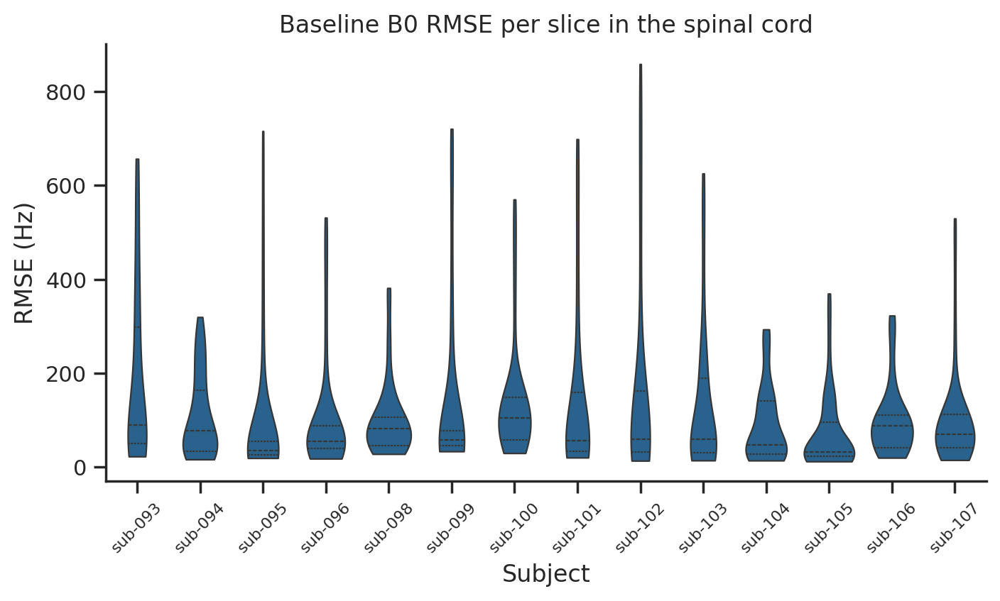
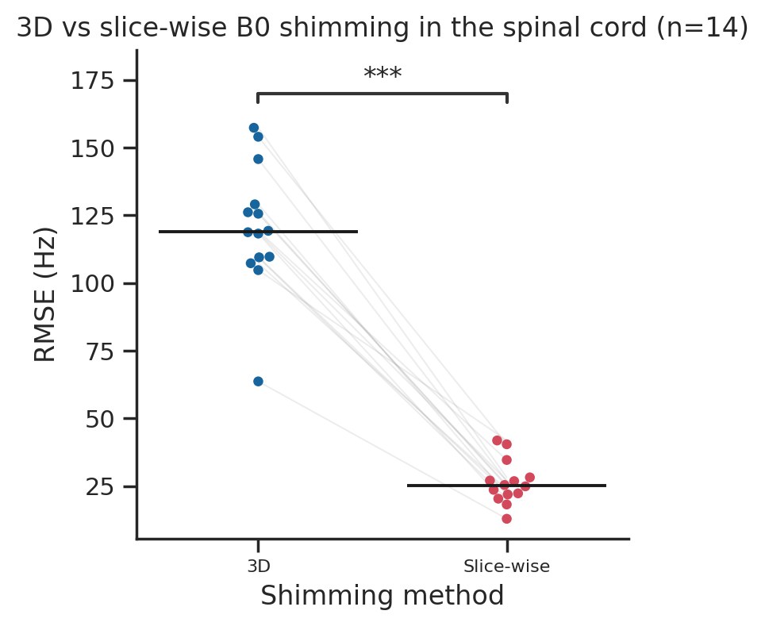

---
# Spine B0 homogeneity at 7T: comparison of 3D and slice-wise scanner shimming
*An ING8100 project*
## Background
### Background - Magnetic field inhomogeneities
MRI relies on a uniform main magnetic field (B0) to produce high-quality images. In practice, when a patient is inside the scanner bore, field inhomogeneities appear.
- **Static inhomogeneities** are constant over time and come from magnetic susceptibility differences between adjacent tissues (e.g., air–tissue interfaces at the lungs, throat, and sinuses).

### Background - B0 shimming techniques
Fortunately, shimming, a process that adjusts the currents in a set of conducting coils (or shims), generates additional magnetic fields that compensate for the main field inhomogeneities. There are multiple ways to perform shimming, depending on how many regions of interest (ROIs) are shimmed separately:
- **Volume (3D) shimming** uses one set of shim coefficients for the entire acquisition. It is also called static shimming.
- **Slice-wise (2D) shimming** uses one set of shim coefficients per slice, updated for every slice during the acquisition.

### Background - Limitations of 2D shimming
In practice, 2D shimming should outperform 3D shimming, or at worst perform equally, since the same shim degrees of freedom are used to correct smaller regions (Insert paper here). However, some acquisitions are incompatible with slice-wise shimming, such as any 3D sequence (e.g., 3D multi-echo GRE). 3D sequences encode the signal from the whole volume at once rather than slice by slice, so slice-wise shimming is not possible. They are nevertheless very useful to obtain a higher SNR, which is important for small ROIs such as the spinal cord.

## Main question
Given that slice-wise shimming cannot be used with 3D sequences, it is important to quantify the difference between 3D shimming and slice-wise shimming in the cervical spinal cord.

  
How large is the difference in B0 field homogeneity after slice-wise shimming compared with volume shimming?

## Methods

### Data
The data is subset of the dataset from the open dataset *spine_fMRI_7T* (D'Astous et al.), available on OpenNeuro under a CC0 license ([ds007067, v4.0.0](https://openneuro.org/datasets/ds007067/versions/4.0.0), doi:10.18112/openneuro.ds007067.v4.0.0) and mirrored on [Borealis](https://demo.borealisdata.ca/dataset.xhtml?persistentId=doi:10.80240/FK2/KRFTCT). 

The B0 field maps were acquired on a Siemens 7T scanner (syngo MR E12) with a 20-channel receive coil for the cervical spine, using a dual-echo 2D gradient-echo field mapping sequence with the following parameters:

| Parameter | Value |
|---|---|
| Echo times (TE1 / TE2) | 2.83 ms / 3.85 ms |
| Repetition time | 329 ms |
| Flip angle | 21° |
| Matrix | 64 × 64 |
| Number of slices | 60 (axial, tilted toward coronal) |
| Voxel size | 3.0 × 3.0 × 2.5 mm³ |
| Multiband factor | 2 |
| Pixel bandwidth | 910 Hz/pixel |

### Dataset Summary

| Dataset | N |
|---|---|---|---|---|
| ds007067 (v4.0.0) | 14 | 

The 14 subjects included are sub-093 to sub-107 (sub-097 is not part of the dataset).

### Spinal cord segmentation
The spinal cord was segmented automatically on the first magnitude image with the contrast-agnostic deep learning model of the Spinal Cord Toolbox. The  mask was then dilated by 2 voxels with a ball-shaped kernel to include the tissue surrounding the cord.(`scripts/create_sc_masks.sh`).

### Shimming simulation
Shimming was simulated with the Shimming Toolbox (D'Astous et al., 2023) using `st_b0shim dynamic` (`scripts/compare_shim.sh`). For each subject, the baseline field map was used both as the input field and as the target, and the spinal cord mask defined the ROI to optimize. Both methods used the same settings, so that the only difference between them is the number of shim regions:
- **Shim system**: scanner coils of order 0 and 1, i.e., the center frequency (f0) and the three linear gradients (x, y, z), for a total of 4 degrees of freedom.
- **Optimizer**: pseudo-inverse (unconstrained least squares).
- **Mask dilation kernel size**: 3.
- **Volume (3D) shimming**: `--slices volume`, a single set of shim coefficients optimized over the whole mask.
- **Slice-wise (2D) shimming**: `--slices auto`, one set of shim coefficients per slice group, the groups being determined automatically from the slice acquisition order (slices excited simultaneously with multiband share the same coefficients).

For each method, Shimming Toolbox outputs the predicted shimmed field map inside the mask (`fieldmap_calculated_shim_masked.nii.gz`) together with the shim coefficients.

### Analysis
B0 homogeneity was quantified with the root mean square error (RMSE) of the field, in Hz, inside the spinal cord ROI (`scripts/analysis.py`). Since the target field is 0 Hz, the RMSE measures how far the remaining field is from a perfectly homogeneous field(0 everywhere):

$$\text{RMSE} = \sqrt{\frac{1}{N}\sum_{i=1}^{N} \Delta B_{0,i}^2}$$

where $N$ is the number of voxels in the ROI and $\Delta B_{0,i}$ is the field offset in voxel $i$.

1. **Baseline**: the RMSE of the unshimmed field map was computed slice by slice inside the same ROI as the shimmed outputs, to characterize the initial inhomogeneity along the cord.
2. **Shimmed fields**: the RMSE of the volume and slice-wise shimmed field maps was computed slice by slice, then combined into one value per subject and method by taking the root mean square across slices.
3. **Statistics**: the per-subject RMSE values of the two methods were compared with a paired, two-sided Wilcoxon signed-rank test (n = 14), chosen because of the small sample size and the absence of a normality assumption.

## Results

### Baseline B0 inhomogeneity

*Figure 1. Distribution of the baseline (unshimmed) B0 RMSE across slices in the spinal cord ROI, for each subject. Dashed lines show the median and quartiles.*

### Volume (3D) vs slice-wise shimming
Both shimming methods reduced the field inhomogeneity compared with the baseline, but slice-wise shimming performed far better (Figure 2 and Table 1):
- **Volume shimming** reduced the RMSE to 120.7 ± 23.5 Hz (range 63.7–157.3 Hz), a mean reduction of 28.6% relative to the baseline.
- **Slice-wise shimming** reduced the RMSE to 26.3 ± 8.0 Hz (range 12.9–41.9 Hz), a mean reduction of 84.1% relative to the baseline.

Slice-wise shimming outperformed volume shimming in all 14 subjects. The RMSE was lower by 94.3 ± 20.8 Hz in absolute terms, or 78.0 ± 6.3% relative to volume shimming. This difference was statistically significant (Wilcoxon signed-rank test, W = 0, p = 1.2 × 10⁻⁴).

*Figure 2. B0 RMSE in the spinal cord after volume (3D) and slice-wise shimming. Each dot is a subject, gray lines link the two methods for the same subject, and black lines show the median. \*\*\*: p < 0.001 (Wilcoxon signed-rank test).*

*Table 1. B0 RMSE (Hz) in the spinal cord ROI for each subject.*

| Subject | Baseline | Volume (3D) | Slice-wise |
|---|---|---|---|
| sub-093 | 267.2 | 107.3 | 23.6 |
| sub-094 | 138.8 | 119.3 | 34.6 |
| sub-095 | 180.8 | 125.6 | 25.4 |
| sub-096 | 154.7 | 129.1 | 21.9 |
| sub-098 | 130.2 | 104.8 | 41.9 |
| sub-099 | 228.5 | 154.0 | 40.4 |
| sub-100 | 183.2 | 145.8 | 26.8 |
| sub-101 | 225.6 | 126.1 | 24.9 |
| sub-102 | 273.0 | 157.3 | 28.2 |
| sub-103 | 197.7 | 118.3 | 18.2 |
| sub-104 | 120.6 | 109.7 | 22.3 |
| sub-105 | 107.8 | 63.7 | 12.9 |
| sub-106 | 127.7 | 118.8 | 27.0 |
| sub-107 | 143.4 | 109.5 | 20.4 |
| **Mean ± SD** | **177.1 ± 54.4** | **120.7 ± 23.5** | **26.3 ± 8.0** |

## Discussion
Before shimming, the B0 field in the spinal cord ROI was highly inhomogeneous, with a per-subject RMSE of 177.1 ± 54.4 Hz (mean ± SD; range 107.8–273.0 Hz). The inhomogeneity was also very uneven along the cord (Figure 1). Most slices had a moderate RMSE (median of all slices: 62.1 Hz), but every subject had a long tail of slices with a much larger offset, up to 293–859 Hz. In 10 of the 14 subjects, the worst slice was the most inferior one, closest to the lungs. 

## Conclusion  

## Acknowledgments

## References
- Alonso Ortiz, E., Tous, C., Topfer, R., & Cohen-Adad, J. (2020, August). Real-time z-shimming for magnetic resonance imaging of the spinal cord [Paper]. ISMRM & SMRT annual Meeting & Exhibition (ISMRM 2020). https://archive.ismrm.org/2020/3717.html
- Bréheret A. et al. *Impact of through-slice gradient optimization for dynamic slice-wise shimming in the cervico-thoracic spinal cord.* Magn Reson Med, 2025.
- D'Astous A. et al. *Shimming toolbox: An open-source software toolbox for B0 and B1 shimming in MRI.* Magn Reson Med, 2023;89:1401-1417.
- D'Astous A., Landelle C., Bréhéret A., Guénette A., Doyon J., Alonso-Ortiz E., Cohen-Adad J. *spine_fMRI_7T.* OpenNeuro, ds007067, v4.0.0. doi:10.18112/openneuro.ds007067.v4.0.0
- Topfer R. et al. *A 24-channel shim array for the human spinal cord: design, evaluation, and application.* Magn Reson Med, 2016;76:1604-1611.

‌
